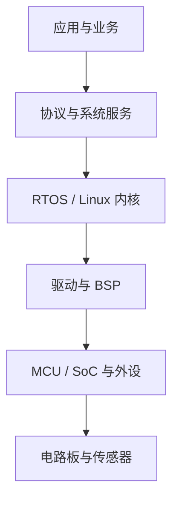

# 0.1 嵌入式岗位地图

> 本节目标：看清“嵌入式工程师”不是一个岗位，而是一组能力相近、侧重点不同的岗位；据此选择自己的主攻方向。

## 嵌入式软件的分层

越往上，越接近业务、网络和产品；越往下，越接近寄存器、时序和硬件。转岗初期不需要每一层都精通，但必须能沿着一条故障链上下追踪。

## 常见岗位

| 岗位 | 主要工作 | 核心能力 | 前端迁移难度 |
| --- | --- | --- | --- |
| MCU 固件工程师 | 裸机、外设驱动、RTOS 应用 | C、寄存器、中断、时序 | 中 |
| RTOS 应用工程师 | 多任务架构、通信、稳定性 | FreeRTOS/Zephyr、并发、内存 | 中 |
| BSP/驱动工程师 | 板级支持、Linux 驱动、启动 | 内核、设备树、硬件手册 | 高 |
| IoT/边缘网关工程师 | 设备接入、协议转换、OTA | 网络、MQTT、Linux、安全 | 低到中 |
| 汽车电子工程师 | ECU、CAN、诊断、功能安全 | CAN、AUTOSAR、可靠性 | 中到高 |
| 机器人/控制工程师 | 运动控制、传感器融合 | 控制理论、实时系统、C++ | 高 |

对于有 7 年前端经验的读者，最顺滑的切入点是 **MCU 固件 + IoT 网关**：前者补齐底层能力，后者能复用 HTTP、WebSocket、MQTT、可视化和工程化经验。

## 典型工作日

嵌入式工程师的一天通常不是“写很多新代码”，而是：

1. 读需求、原理图和芯片手册，确认接口与时序。
2. 在开发板上复现问题，使用串口日志、调试器和逻辑分析仪定位。
3. 修改驱动或任务逻辑，做回归测试。
4. 更新版本、测试记录、生产说明和问题单。
5. 与硬件、测试、云端和生产团队对齐边界。

这也是为什么课程反复强调“可观测性”和“排障”：嵌入式软件的难度，很大一部分来自你看不见内部状态。

## 岗位能力矩阵

| 能力 | 初级要求 | 中级要求 |
| --- | --- | --- |
| C 语言 | 能读懂并修改驱动代码 | 能设计可测试的模块，理解内存与链接 |
| 硬件 | 能按图接线、查引脚 | 能读时序图、定位电气与协议问题 |
| MCU | 会用 HAL 配外设 | 理解启动、时钟、中断、DMA 和低功耗 |
| RTOS | 会创建任务和队列 | 能做优先级、栈、死锁和资源预算 |
| 通信 | 会调 UART/I2C/SPI | 能设计帧协议、恢复机制和网关 |
| 工程化 | 会 Git、编译、烧录 | 会 CI、测试、OTA、版本与量产维护 |

## 如何选择方向

- 想尽快转岗、复用 Web 经验：优先 **IoT/边缘网关 + MCU 基础**。
- 想进入更底层的软件岗位：优先 **MCU 固件 + RTOS**，再补 Linux。
- 想进入 Linux/BSP：需要更长的周期，重点补操作系统、驱动和硬件。
- 想进入汽车电子：在 C、CAN、可靠性和功能安全上继续深入。

## 动手练习

找 5 份你目标城市的嵌入式岗位 JD，把要求分成四类：

1. 语言与计算机基础。
2. MCU/RTOS/Linux 平台能力。
3. 通信、硬件与调试能力。
4. 行业知识与工程化能力。

把每一條映射到本课程章节。无法映射的要求，就是后续需要单独补的缺口。

## 检查清单

- [ ] 能说出 MCU 固件、BSP、IoT 网关三类岗位的差异。
- [ ] 知道自己当前最匹配的切入方向。
- [ ] 能解释为什么“会写 C”不等于“会做嵌入式”。
- [ ] 已收集 5 份目标岗位 JD 并完成能力映射。

