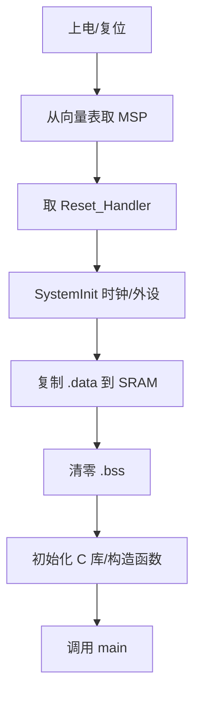

# 2.5 链接脚本、启动流程与 Map 文件

> 本节目标：能解释 MCU 上电后如何找到栈顶、复位向量和 `main`，以及 `.data`、`.bss` 是如何初始化的。

## 启动流程



向量表的前两项固定是初始栈指针和复位处理函数地址。

## 向量表

```c
extern uint32_t _estack;
void Reset_Handler(void);
void Default_Handler(void);

__attribute__((section(".isr_vector")))
const void *vector_table[] = {
    &_estack,
    Reset_Handler,
    NMI_Handler,
    HardFault_Handler,
    /* ... 其他异常和外设中断 ... */
};
```

第一项是栈顶地址，第二项是复位入口。中断发生时，NVIC 根据异常编号从表中取函数地址。

## 链接脚本的关键部分

```text
ENTRY(Reset_Handler)

MEMORY
{
  FLASH (rx)  : ORIGIN = 0x08000000, LENGTH = 512K
  RAM   (xrw) : ORIGIN = 0x20000000, LENGTH = 128K
}

_estack = ORIGIN(RAM) + LENGTH(RAM);

SECTIONS
{
  .isr_vector :
  {
    KEEP(*(.isr_vector))
  } > FLASH

  .text :
  {
    *(.text*)
    *(.rodata*)
    _etext = .;
  } > FLASH

  .data : AT(_etext)
  {
    _sdata = .;
    *(.data*)
    _edata = .;
  } > RAM

  .bss :
  {
    _sbss = .;
    *(.bss*)
    *(COMMON)
    _ebss = .;
  } > RAM
}
```

这只是教学版，真实工程还要处理堆、栈、启动代码、库段、对齐和保留区。

## 启动代码

```c
extern uint32_t _sidata;
extern uint32_t _sdata;
extern uint32_t _edata;
extern uint32_t _sbss;
extern uint32_t _ebss;
extern int main(void);

void Reset_Handler(void)
{
    uint32_t *src = &_sidata;
    uint32_t *dst = &_sdata;

    while (dst < &_edata) {
        *dst++ = *src++;
    }

    for (dst = &_sbss; dst < &_ebss; ++dst) {
        *dst = 0U;
    }

    SystemInit();
    __libc_init_array();
    (void)main();

    for (;;) {
        /* main 不应返回 */
    }
}
```

注意 `.data` 的初值在 Flash 中，运行时目标地址在 SRAM，所以需要复制。`.bss` 不占 Flash，但必须在启动时清零。

## Map 文件看什么

- 向量表是否在 Flash 起始地址。
- `.text` 是否超过 Flash 容量。
- `.data` 初值是否放在 Flash，运行时地址是否在 SRAM。
- `.bss` 和栈是否超过 SRAM。
- 有没有未使用但被链接进来的库。
- 栈和堆的边界是否留有余量。

```bash
arm-none-eabi-size -A firmware.elf
arm-none-eabi-objdump -h firmware.elf
```

## 常见问题

- 向量表没有 `KEEP`，被链接器裁剪，复位后跑飞。
- 链接脚本的 RAM 长度写错，变量覆盖栈。
- `.data` 复制源地址写错，全局变量初值异常。
- `main` 返回后没有兜底循环。
- Bootloader 和应用程序的向量表偏移没有设置 `SCB->VTOR`。

## 动手实验

1. 编译工程并找到 `.map` 文件。
2. 搜索 `Reset_Handler`、`_estack`、`_sdata`、`_ebss` 的地址。
3. 修改一个全局变量初值，观察它是否出现在 `.data` 的 Flash 初值区。
4. 添加一个大数组，观察 SRAM 占用变化。
5. 把向量表改成非起始地址，观察启动行为。

## 检查清单

- [ ] 能解释上电后如何取得栈顶和复位入口。
- [ ] 能读懂链接脚本的 MEMORY 和 SECTIONS。
- [ ] 知道 `.data` 复制和 `.bss` 清零的时机。
- [ ] 能检查 Map 文件中的 Flash/SRAM 占用。
- [ ] 知道 Bootloader 场景下要设置向量表偏移。
