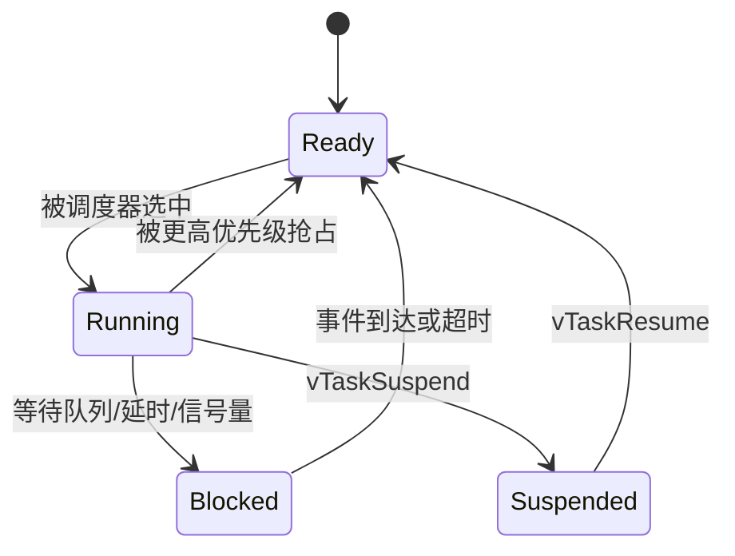

# 3.2 任务、调度器与优先级

> 本节目标：会创建任务、选择优先级、使用周期延时，并能解释调度器为什么选中某个任务。

## 创建任务

```c
static void sensor_task(void *argument)
{
    (void)argument;
    TickType_t last_wake = xTaskGetTickCount();

    for (;;) {
        sensor_sample_t sample;
        if (sensor_read(&sample) == OK) {
            xQueueSend(sample_queue, &sample, pdMS_TO_TICKS(10));
        }
        vTaskDelayUntil(&last_wake, pdMS_TO_TICKS(100));
    }
}

void app_start(void)
{
    xTaskCreate(sensor_task, "sensor", 512, NULL, 3, NULL);
    vTaskStartScheduler();
}
```

FreeRTOS 的栈大小通常以 **word** 为单位。Cortex-M 上一个 word 是 4 字节，`512` 约等于 2 KB，具体以移植层定义为准。

## 任务状态



调度器只在 Ready 任务中选择最高优先级者。相同优先级任务通常按时间片轮转（如果启用）。

## 优先级设计

优先级反映“响应紧迫程度”，不是“代码重要性”。建议分层：

| 优先级 | 任务 |
| --- | --- |
| 最高 | 安全保护、硬件故障处理 |
| 高 | 高速通信、控制环 |
| 中 | 传感器采集、协议解析 |
| 低 | 显示、日志、统计 |
| 最低 | 空闲任务、后台维护 |

不要把所有任务都设成最高优先级，否则高优先级失去意义。

## 周期任务

```c
TickType_t last = xTaskGetTickCount();

for (;;) {
    do_work();
    vTaskDelayUntil(&last, pdMS_TO_TICKS(50));
}
```

`vTaskDelayUntil` 基于绝对时间，能减少累积漂移；`vTaskDelay` 是相对当前时间延时。

## 空闲任务

调度器启动时会创建空闲任务，用于清理已删除任务和低功耗钩子。空闲任务不能被长期饿死，否则删除任务占用的内存无法回收，低功耗也无法进入。

## 启动顺序

1. 初始化硬件和 RTOS 对象（队列、信号量）。
2. 创建任务。
3. 启动调度器，之后 `main` 不再继续执行。
4. 中断可以在此之前使能，但要注意 RTOS 对象已初始化。

## 常见坑

- 任务函数返回，导致未定义行为。
- 栈单位误以为是字节，分配过小。
- 所有任务同优先级，关键任务得不到及时响应。
- 在任务中使用 `HAL_Delay()`，阻塞整个调度。
- 创建任务失败但没有检查返回值。

## 动手实验

1. 创建三个不同优先级的任务，各自翻转不同 LED。
2. 在高优先级任务中忙等，观察低优先级任务是否饥饿。
3. 用 `vTaskDelayUntil` 实现 100 ms 周期采集，测量抖动。
4. 用 `uxTaskGetSystemState` 查看任务状态和栈高水位。

## 检查清单

- [ ] 能解释 Ready、Running、Blocked、Suspended。
- [ ] 知道栈大小的单位。
- [ ] 能根据响应要求设计优先级。
- [ ] 周期任务优先使用 `vTaskDelayUntil`。
- [ ] 知道空闲任务的作用。

