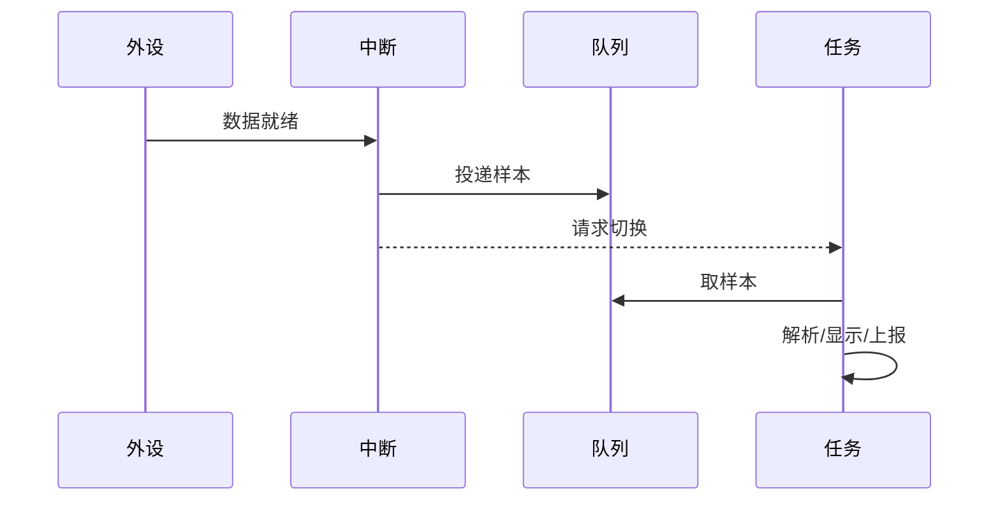

# 3.4 中断与任务通信

> 本节目标：掌握中断到任务的单向数据流，避免在 ISR 中调用阻塞 API 或破坏 RTOS 内部状态。

## 基本原则

中断服务程序只做：

1. 确认中断来源。
2. 清除硬件标志。
3. 把最小数据投递给任务。
4. 必要时请求任务切换。

业务处理、日志、协议解析和显示刷新都放到任务中。

## 队列 FromISR

```c
void USART2_IRQHandler(void)
{
    BaseType_t woken = pdFALSE;
    uint8_t byte = read_uart_data();

    if (xQueueSendFromISR(uart_rx_queue, &byte, &woken) != pdPASS) {
        uart_rx_overflow_count++;
    }

    portYIELD_FROM_ISR(woken);
}
```

`xQueueSendFromISR` 不会阻塞。队列满时立即返回失败，ISR 必须决定丢弃、计数或置错误标志。

## 信号量 FromISR

```c
void EXTI15_10_IRQHandler(void)
{
    BaseType_t woken = pdFALSE;

    if (EXTI_GetITStatus(EXTI_Line13) != RESET) {
        EXTI_ClearITPendingBit(EXTI_Line13);
        xSemaphoreGiveFromISR(button_sem, &woken);
    }

    portYIELD_FROM_ISR(woken);
}
```

二值信号量只表示“事件发生”，不携带具体数据。如果需要知道按键按了几次，用计数信号量或队列。

## 任务通知 FromISR

```c
void DMA_IRQHandler(void)
{
    BaseType_t woken = pdFALSE;
    vTaskNotifyGiveFromISR(adc_task, &woken);
    portYIELD_FROM_ISR(woken);
}
```

任务通知最轻量，但只适合一对一通知，且要注意通知值可能被覆盖。

## 中断优先级约束

FreeRTOS 通过 `configMAX_SYSCALL_INTERRUPT_PRIORITY` 划分可调用 RTOS API 的中断优先级范围：

- 优先级数值高于阈值（逻辑优先级更低）的中断可以调用 `FromISR` API。
- 更高优先级的中断不能调用 RTOS API，否则会破坏内核。
- `portYIELD_FROM_ISR` 只能在 ISR 中使用。

Cortex-M 的优先级数值和“逻辑优先级”容易混淆，配置时要查移植层说明。

## 延迟处理模式



这就是“上半部/下半部”思想：中断做最小工作，任务做重活。

## 常见坑

- 在 ISR 中调用 `xQueueSend` 而不是 `xQueueSendFromISR`。
- 忘记 `portYIELD_FROM_ISR`，任务要等下一次 tick 才运行。
- 在 ISR 中调用 `malloc`、`printf` 或阻塞 I2C。
- 中断优先级高于 RTOS 可管理范围，却调用 RTOS API。
- ISR 中共享变量没有 `volatile` 或原子保护。

## 动手实验

1. 用 UART 中断接收字节，通过队列交给解析任务。
2. 对比“ISR 直接解析”和“ISR 投递 + 任务解析”的响应时间。
3. 故意在 ISR 中调用阻塞 API，观察断言或系统异常。
4. 用逻辑分析仪测量从中断触发到任务处理的延迟。

## 检查清单

- [ ] ISR 只做最小工作并清中断标志。
- [ ] 使用正确的 FromISR API。
- [ ] 理解 `portYIELD_FROM_ISR` 的作用。
- [ ] 中断优先级符合 RTOS 配置约束。
- [ ] 中断到任务的数据流有明确容量和溢出策略。

