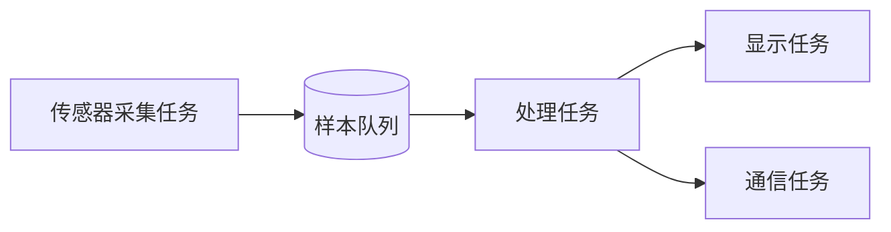

# 3.10 架构设计模式

> 本节目标：把“能跑的任务”升级为可维护的固件架构，掌握生产者-消费者、发布-订阅、状态机和活动对象。

## 生产者-消费者



特征：

- 生产者只负责产生数据。
- 消费者只负责处理数据。
- 队列容量、溢出策略和背压必须明确。

这是环境监测、音频采样、日志系统最常用的结构。

## 发布-订阅

一个事件源，多个消费者：

```text
按键事件 -> 事件总线 -> UI 状态机
                     -> 蜂鸣器
                     -> 日志
```

FreeRTOS 没有内置发布-订阅，可以用多个队列、事件组或轻量事件总线实现。注意每个订阅者的队列满时不能阻塞发布者。

## 状态机 + 事件队列

```c
typedef struct {
    app_state_t state;
    QueueHandle_t events;
} app_ctx_t;

void app_task(void *arg)
{
    app_ctx_t *ctx = arg;
    app_event_t event;

    for (;;) {
        if (xQueueReceive(ctx->events, &event, portMAX_DELAY) == pdPASS) {
            app_state_handle(ctx, &event);
        }
    }
}
```

所有输入（按键、串口、网络、定时器）都转成事件，状态机成为唯一业务入口，便于测试和追踪。

## 活动对象

活动对象 = 私有状态 + 事件队列 + 单任务。对象只在自己的任务中修改状态，外部通过消息通信。

优点：

- 不需要为对象状态加锁。
- 事件顺序确定。
- 易于单测状态转换。

代价：每个对象一个任务和栈，任务数量要控制。

## 分层架构

```text
app/          业务状态机、用例
services/     协议、存储、设备管理
drivers/      传感器、通信外设
platform/     MCU/RTOS 适配
```

依赖方向应从上到下。业务层不直接调用 HAL，驱动层不包含业务规则。

## 错误与日志

- 每个模块返回统一错误码。
- 错误在边界处转换为用户可见状态。
- 日志分级：ERROR、WARN、INFO、DEBUG。
- 高频日志进入环形缓冲区，由低优先级任务输出。

## 常见坏味道

- 一个任务里塞满所有业务。
- 任务之间直接读写全局变量。
- 回调里修改别人的状态。
- 队列无限等待，系统无法降级。
- 业务层直接调用 `HAL_GPIO_WritePin`。
- 每个模块都创建一个任务。

## 动手实验

把环境监测项目重构为：

1. `sensor_task` 只采集并发送样本。
2. `app_task` 消费样本、更新状态机。
3. `display_task` 只负责渲染。
4. `comm_task` 只负责上报。
5. 所有任务通过队列/事件通信。

画出数据流图，并标出每个队列的容量和溢出策略。

## 检查清单

- [ ] 能根据数据流划分任务。
- [ ] 队列容量和溢出策略明确。
- [ ] 业务状态只在一个上下文中修改。
- [ ] 分层依赖方向清晰。
- [ ] 没有模块通过全局变量偷偷共享状态。

