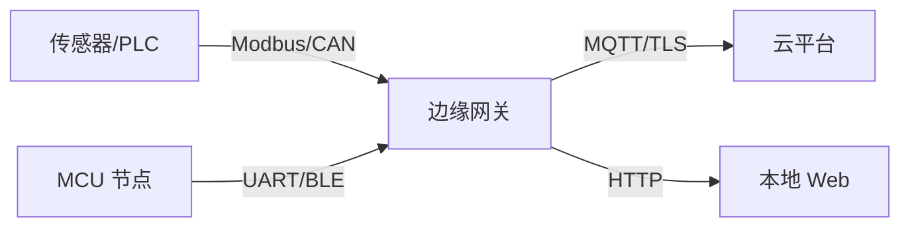

# 4.7 边缘网关设计

> 本节目标：理解边缘网关的职责，设计采集、协议转换、缓存、补传和远程管理链路。

## 网关的职责



网关通常不是“协议翻译器”这么简单，它还要负责：

- 设备发现与注册。
- 采集调度与超时。
- 数据清洗、单位换算、时间戳。
- 本地缓存与断网补传。
- 规则/告警/本地控制。
- 远程配置与 OTA。
- 日志、指标和远程诊断。

## 采集层

每个现场设备定义：

- 连接参数（串口、波特率、地址）。
- 采集周期和超时。
- 数据类型与换算。
- 错误重试策略。
- 数据质量标记。

采集任务不要把“读取失败”当成“值为 0”。失败应标记为无效，并保留上次有效值和时间戳。

## 协议转换

现场协议（Modbus/CAN/私有串口）转换为统一内部模型：

```c
typedef struct {
    char device_id[24];
    char point_id[24];
    double value;
    uint64_t timestamp_ms;
    uint8_t quality;
} data_point_t;
```

统一模型让云端和 Web 不必理解每种现场协议。

## 断网缓存

```text
采集 -> 内存队列 -> 批量写盘 -> 网络可用 -> 按序补传 -> 确认后删除
```

要点：

- 缓存有容量上限和淘汰策略。
- 使用追加日志或环形文件，避免频繁擦写。
- 每条记录有唯一 ID，云端去重。
- 补传限速，避免恢复瞬间打爆网络。
- 断电恢复后能校验文件完整性。

## 时间同步

现场数据必须带可信时间戳：

- 启动时从 RTC/网络获取时间。
- 断网时使用单调时钟累计。
- 恢复网络后校准，但不要回退已发送数据的时间。
- 记录时间源和质量。

## 远程管理

- 设备影子/期望状态。
- 配置版本与回滚。
- OTA 分片下载、校验、双分区。
- 远程日志级别调整。
- 诊断命令带权限和审计。

## 常见坑

- 采集失败写 0，云端误判。
- 缓存无上限，Flash 写满。
- 补传没有去重，云端重复计费。
- 网关重启后设备状态丢失。
- 远程命令没有鉴权。
- OTA 失败后无法回滚。

## 动手实验

1. 用 Raspberry Pi 做网关，采集一个 Modbus 设备。
2. 转换为 MQTT JSON 上报到本地 Broker。
3. 拔网线 10 分钟，验证本地缓存和补传。
4. 用 Web 页面显示设备状态、质量和最后上报时间。
5. 模拟 OTA 失败，验证回滚。

## 检查清单

- [ ] 网关职责不仅是协议转换。
- [ ] 采集失败与真实零值区分。
- [ ] 断网缓存有上限、去重和限速。
- [ ] 时间戳来源和质量可追踪。
- [ ] 远程命令和 OTA 有鉴权与回滚。

