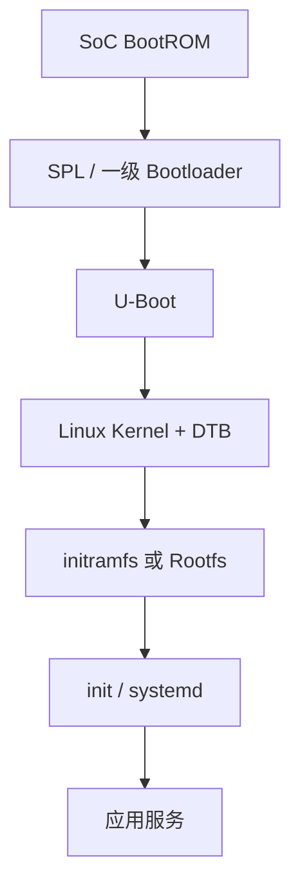

# 5.3 启动流程

> 本节目标：理解 Embedded Linux 的完整启动链，能在串口日志中定位卡在哪个阶段。

## 启动链路



每个阶段都有自己的日志、配置和失败模式。


*图：串口日志停在哪一阶段，问题通常就在上一阶段的交接处。*

## BootROM

SoC 内部固化代码，根据启动模式从 eMMC、SD、NAND、USB 或网络加载下一阶段。它通常不可修改，只做最小初始化。

## SPL / 一级 Bootloader

SPL（Secondary Program Loader）负责初始化 DRAM 等关键硬件，然后把 U-Boot 加载到内存。某些平台没有独立 SPL，由 BootROM 直接加载 U-Boot。

## U-Boot

U-Boot 负责：

- 初始化更多外设。
- 从存储/网络加载内核和 DTB。
- 传递启动参数 `bootargs`。
- 提供串口命令行、烧录和恢复模式。

常见命令：

```text
printenv
setenv bootargs 'console=ttyS0,115200 root=/dev/mmcblk0p2 rw'
boot
```

## Kernel 与 DTB

内核启动后会：

1. 解压/自解压。
2. 初始化内存、调度、中断和驱动框架。
3. 解析设备树，匹配驱动。
4. 挂载 rootfs。
5. 启动第一个用户空间进程。

设备树描述硬件，不再把板级信息硬编码进内核。

## Rootfs 与 init

内核启动 `/sbin/init` 或通过 `init=` 指定的程序。systemd 会按依赖启动服务：

```text
local-fs.target -> network.target -> app.service
```

应用服务需要：

- 正确的依赖顺序。
- 失败重启策略。
- 日志进入 journald。
- 只读根文件系统下的可写数据目录。

## 串口启动日志

启动问题首先看串口日志：

```text
U-Boot 2024.01
Loading kernel from mmc 0:1
Starting kernel ...
[    0.000000] Booting Linux ...
[    2.345678] Run /sbin/init as init process
```

如果卡在：

- U-Boot 前：电源、时钟、启动介质、SPL。
- U-Boot 后：内核镜像地址、DTB、bootargs。
- Kernel 早期：内存、串口、存储驱动。
- Mount rootfs：分区、文件系统、root= 参数。
- init 后：服务依赖、权限、配置。

## 常见问题

- 串口没有输出：波特率、引脚、console 参数。
- 内核 panic：rootfs 找不到或 init 不存在。
- 卡在 `Waiting for root device`：存储驱动/分区错误。
- 服务启动失败：依赖、权限、只读文件系统。
- 时间不对：RTC/NTP 未配置。

## 检查清单

- [ ] 能画出 BootROM 到应用的启动链。
- [ ] 知道 U-Boot 的职责和常用命令。
- [ ] 理解 DTB 与内核的关系。
- [ ] 能根据串口日志定位卡点。
- [ ] 能编写一个 systemd 服务并配置依赖。

