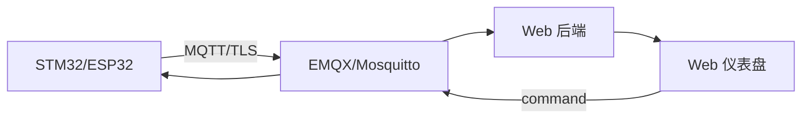

# P4 IoT 网关与 Web 仪表盘

## 目标

把 P3 的数据通过 MQTT 上报到 Broker，并在 Web 仪表盘展示；支持断网缓存、重连补传和 OTA。

## 架构



## 功能

- 设备遥测：温度、湿度、信号、固件版本。
- 设备状态：在线、离线、最后上报时间。
- 命令：修改周期、重启、开始 OTA。
- 断网缓存 24 小时，恢复后补传。
- Web 页面显示趋势、告警和 OTA 进度。

## 主题设计

```text
devices/{id}/telemetry
devices/{id}/status
devices/{id}/command
devices/{id}/command/ack
devices/{id}/ota
```

## Web 端

可以复用前端技术栈：

- Vue/React + Vite。
- WebSocket/MQTT over WebSocket。
- 趋势图、状态卡、告警列表。
- 设备列表和筛选。
- OTA 任务进度。

但设备端仍是主体：Web 只是可观测性的一部分。

## 可靠性要求

- MQTT QoS 1 + 业务去重。
- 重连指数退避。
- LWT 标记离线。
- 缓存有上限和淘汰策略。
- TLS 证书校验开启。
- OTA 包签名校验。

## 验收

- 设备上线 5 秒内出现在仪表盘。
- 拔网线 10 分钟，恢复后数据不丢。
- 重启 Broker，设备自动重连并重新订阅。
- OTA 失败能回滚。
- 页面能显示数据质量和最后更新时间。

## 交付物

- 系统架构图。
- MQTT 主题和消息格式文档。
- 断网/重连测试记录。
- Web 仪表盘截图或视频。
- 一次 Broker 故障复盘。

## 面试表达

> 我做的是端到端链路：设备端用 QoS 1 上报并去重，网关缓存离线数据，Web 端展示设备状态和数据质量。重点不是页面，而是断网、重连和补传的可靠性。

